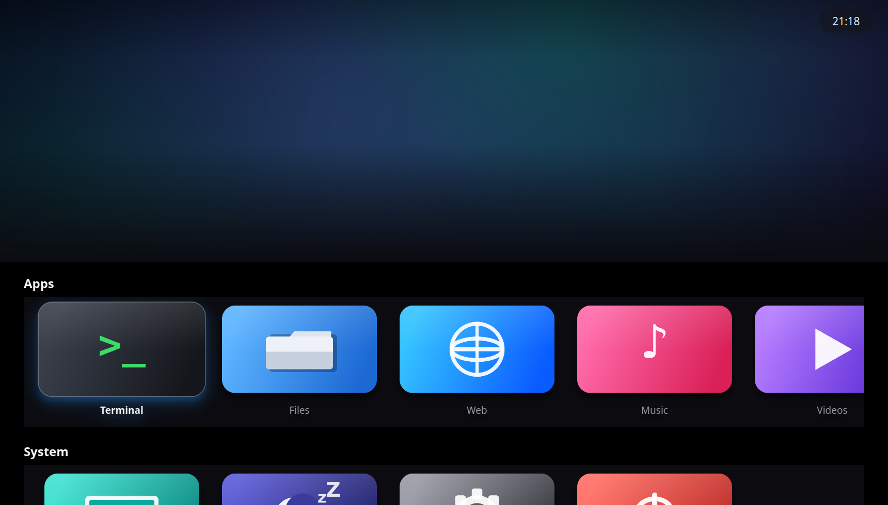
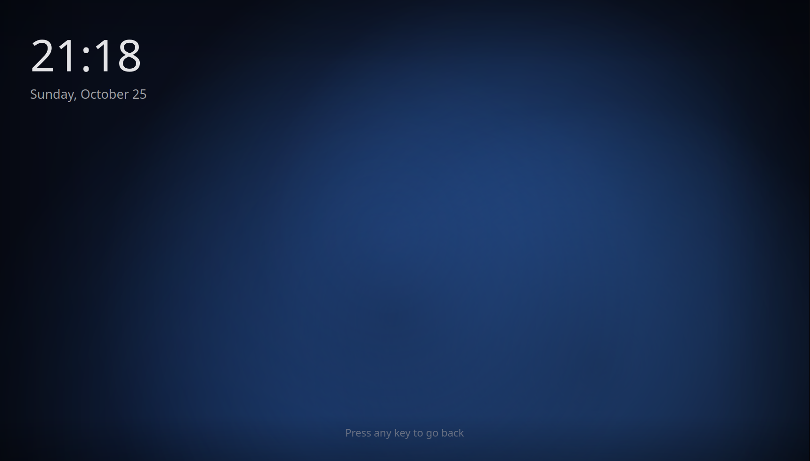

# batalex-launcher

An Apple TV-style application launcher for Linux (and anything else Qt runs on):
fullscreen rows of rounded-rectangle app tiles under a big cinematic hero
picture, with a shuffle screensaver that kicks in when you're not using it.

Inspired by [flex-launcher](https://github.com/complexlogic/flex-launcher),
reimagined with a tvOS look and more polish.

| Home screen | Screensaver |
| --- | --- |
|  |  |

## Features

- **Apple TV look** — full-bleed *hero* picture up top, rows of rounded
  rectangle app tiles below, focus zoom + glow, smooth scrolling, dark theme.
- **Fully configurable** — one YAML file: your rows, your apps, your colors,
  your timers. Apps launch *any* shell command or script.
- **Screensaver** — after 1 minute 30 seconds of no input (configurable), a
  fullscreen screensaver shuffles through a folder of your photos and videos,
  showing each for a minute (configurable). Photos get a slow Ken Burns
  pan/zoom; videos play muted. Any key press, click or mouse movement returns
  to the launcher. A big clock is shown too.
- **Big picture = screensaver library** — the hero on the home screen pulls
  from the same media folders and crossfades on the same cycle.
- **Rectangular app icons** — every app has a wide rectangular image, drawn as
  a rounded rectangle. Ships with generated demo icons; missing icons fall
  back to a generated initial tile.
- **Desktop & Exit tiles** — built-in actions to drop back to the desktop
  (minimizes the launcher and can run a "show desktop" command) or quit the
  launcher entirely. `Esc` quits too (configurable).
- **App-friendly launching** — the launcher hides while an app runs and comes
  back when it exits.
- **TV-friendly** — hides the mouse cursor after a few seconds, works with
  keyboard, mouse, and remotes that send keystrokes.

## Requirements

- Python 3.10+
- [PySide6](https://doc.qt.io/qtforpython/) (Qt for Python) and PyYAML — see
  `requirements.txt`
- For **video** screensavers, Qt Multimedia needs a backend. On Debian/Ubuntu:
  `sudo apt install gstreamer1.0-plugins-base gstreamer1.0-plugins-good
  gstreamer1.0-libav` (photos need nothing extra).

## Quick start

```bash
git clone https://github.com/Stelath/batalex-launcher.git
cd batalex-launcher

python3 -m venv .venv          # any Python 3.10+ works
source .venv/bin/activate
pip install -r requirements.txt

./run.sh                       # fullscreen launcher
# or:
python -m batalex_launcher --windowed   # handy for development
```

On first run the bundled `config/config.yaml` is copied to
`~/.config/batalex-launcher/config.yaml` — **edit that file** to add your own
apps, then restart the launcher.

## Controls

| Input | Action |
| --- | --- |
| Arrow keys / mouse hover | Move focus |
| Enter / Space / left click | Launch the focused app |
| Mouse wheel | Scroll a row horizontally |
| Any input on the screensaver | Back to the launcher |
| `Esc` | Quit the launcher (see `esc_action`) |

## Configuration

Everything lives in `~/.config/batalex-launcher/config.yaml`. The bundled
[`config/config.yaml`](config/config.yaml) is heavily commented; the short
version:

```yaml
launcher:
  idle_seconds: 90            # screensaver delay (1 min 30 s)
  cursor_hide_seconds: 3
  desktop_command: ""         # e.g. "wmctrl -k on" for the Desktop tile
  hide_on_launch: true        # hide launcher while an app runs
  restore_on_exit: true       # come back when the app exits
  esc_action: exit            # exit | desktop | none

appearance:
  background: "#0b0b10"
  text: "#f5f5f7"
  accent: "#2997ff"
  tile_width: 300             # app tiles are rectangles...
  tile_height: 170            # ...16:9-ish by default
  tile_radius: 26             # corner roundness
  focus_zoom: 1.08            # Apple TV focus pop

screensaver:
  enabled: true
  cycle_seconds: 60           # each photo/video shows for a minute
  shuffle: true
  show_clock: true
  clock_24h: true
  media_dirs:                 # folders scanned recursively
    - "../assets/screensaver" # (this one is relative to the config file)
    - "~/Pictures/screensaver"

rows:
  - title: Apps
    items:
      - name: Firefox
        icon: "~/.local/share/batalex-launcher/icons/firefox.png"
        command: "firefox"          # any shell command / script
  - title: System
    items:
      - name: Desktop
        action: desktop             # built-in: minimize to desktop
      - name: Exit
        action: exit                # built-in: quit the launcher
```

### App entries

Each item needs a `name` and either a `command` or an `action`:

- `command` — any shell command, e.g. `"kodi"`, `"~/scripts/start-game.sh"`,
  `"env FOO=1 ./my-app --flag"`. Run through `sh -c`.
- `action` — built-in behavior: `desktop` (minimize the launcher and
  optionally run `launcher.desktop_command`), `exit` (quit the launcher),
  `screensaver` (preview the screensaver immediately).
- `icon` — path to a **rectangular image** (16:9 recommended, at least
  640×360; PNG/JPEG/WebP). Relative paths resolve against the config file's
  directory; `~` and `$VARS` work. Missing/invalid icons render as a colored
  tile with the app's initial.

### The hero (big picture)

The hero uses the same media library as the screensaver by default
(`screensaver.media_dirs`); give `hero.media_dirs` its own list to override.
Photos crossfade and pan/zoom; videos play muted. `hero.cycle_seconds`
defaults to 60, so the big picture shuffles every minute.

## Running at boot / as a TV shell

For a dedicated TV box, run the launcher instead of (or before) a desktop
session. Examples:

**Desktop autostart** — add `batalex-launcher` to your DE's startup
applications.

**Kiosk with Openbox** — `~/.config/openbox/autostart`:

```sh
xset -dpms s off              # let the launcher handle idling, not the DPMS
batalex-launcher &
```

**Systemd user session** — a `~/.config/systemd/user/batalex-launcher.service`
with `ExecStart=/path/to/batalex-launcher/.venv/bin/python -m batalex_launcher`
works too.

## Development

```bash
python tests/smoke.py                    # offscreen functional checks
python tools/generate_assets.py          # regenerate bundled demo artwork
python -m batalex_launcher --screenshot /tmp/home.png          # render tests
python -m batalex_launcher --screensaver-shot /tmp/saver.png
```

Layout: `batalex_launcher/config.py` (YAML → dataclasses), `media.py` (media
scanning), `media_widgets.py` (Ken Burns/crossfade/video/cyclers/clocks),
`widgets.py` (tiles & rows), `hero.py`, `screensaver.py`, `mainwindow.py`,
`__main__.py`.

## Troubleshooting

- **Videos don't play in the screensaver** — install GStreamer plugins (see
  Requirements). The launcher logs skipped videos and keeps cycling photos.
- **Wayland quirks** — minimizing a fullscreen window is WM-dependent; the
  `desktop` action may need a `desktop_command` (e.g. `wmctrl -k on` on X11).
- **Slow focus animations** — `appearance.focus_zoom` and the drop shadows are
  the priciest bits; reduce the number of tiles per row on low-power devices.

## License

[MIT](LICENSE)
